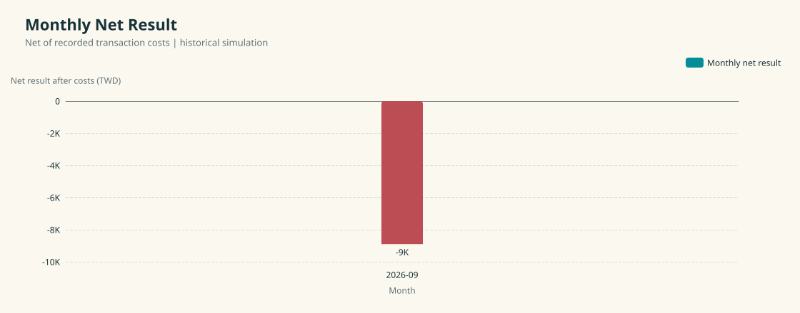

# Stock Decision System

A stock decision system I am building to connect observation, entry, holding, and exit decisions across trading days.

> 我開發的股票決策系統，將觀察、進場、持有與退出串成跨交易日的決策流程。這裡展示目前完成的能力、驗證結果，以及後續開發進度。

## What I Have Built

- A decision flow that carries state across trading days.
- Historical replay to evaluate decisions over multi-day tasks.
- Result summaries that account for recorded transaction costs and capital usage.
- Monthly charts and reports for reviewing development progress over time.

```text
Observe -> Enter -> Hold -> Exit
```

## Results

The first monthly evaluation covers September 2026. The recorded net result was **TWD −8,904**, including **TWD 8,904** in transaction costs, across 10 completed evaluations. This gives me an initial view of how the decision flow behaves and how costs affect the outcome.



[View the full results, cost breakdown, and observations →](REPORT.md)

## What I Am Building Next

- Extend evaluation across more months to see how consistently the system performs.
- Compare net results alongside transaction costs and recorded capital usage.
- Track changes across development versions using comparable evaluation settings.

## About These Results

The results come from historical simulation. The initial sample is small, and profitability has not been established. Evaluation scope and limitations are included in the [full report](REPORT.md#evaluation-context).

This repository presents development results and aggregate measurements. The system implementation and detailed evaluation data are maintained separately.
