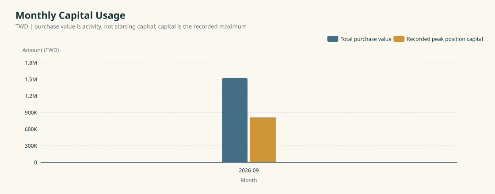
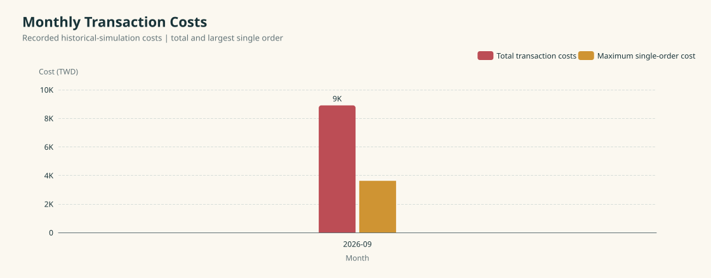

# Stock Decision Research Report

> Historical-simulation aggregates only. This is not actual execution, financial advice, or evidence of future profitability.

## This Month

| Period | Public revision | Protocol | Months | Validation days | Evaluations |
|---|---|---|---:|---:|---:|
| 2026-09 to 2026-09 | `research-v0.1` | `historical-simulation-draft` | 1 | 21 | 10 |

| Net result after costs | Total purchase value | Recorded peak position capital | Total transaction costs | Largest single-order cost |
|---:|---:|---:|---:|---:|
| TWD -8,904 | TWD 1,522,000 | TWD 810,153 | TWD 8,904 | TWD 3,620 |

All monetary amounts are in TWD. Total purchase value is the sum of purchases during the period; it is not starting capital. Recorded peak position capital is the maximum capital value supplied by the evaluation, not an assumed portfolio-wide funding requirement. Total costs and the largest single-order cost are distinct measures. Net result already includes recorded costs; do not subtract them again.

This first monthly observation does not establish a trend. The report focuses on the month's result, costs, and research observations.

## Monthly Research Notes

### 2026-09

- **Finding:** Recorded net result after costs: TWD -8,904; recorded transaction costs: TWD 8,904.
- **Limitation:** This month's summary contains 10 evaluations with status `validated`. These aggregates alone do not establish sample representativeness or persistent performance. See the report limitations for context.
- **Next step:** Compare the next available month under a compatible revision and protocol, tracking net result, costs, and recorded capital together.

## 1. Monthly Net Result

Net result after recorded costs for this month.

## 2. Monthly Capital Usage

Total purchase value and recorded peak position capital, shown on the same TWD scale. Purchase value measures activity, not starting capital.

## 3. Monthly Transaction Costs

How much did recorded transaction costs consume, and how large was the largest single-order cost each month?

## Monthly Ledger

| Month | Status | Days | Evaluations | Net result after costs | Total purchase value | Recorded peak position capital | Total costs | Largest single-order cost |
|---|---|---:|---:|---:|---:|---:|---:|---:|
| 2026-09 | validated | 21 | 10 | TWD -8,904 | TWD 1,522,000 | TWD 810,153 | TWD 8,904 | TWD 3,620 |

## Limitations

- Initial monthly observation with a small evaluation sample; it does not establish a trend.
- Source-selection coverage and the validation-day counting convention remain to be clarified.
- The monthly result is marked validated; the broader combined evaluation remains partial.
- The validation protocol label is provisional. Confirm comparability before pooling later months.

## Interpretation boundary

Net result, notional, capital, and transaction costs are historical-simulation measurements. Month-to-month comparisons are meaningful only when the public revision and validation protocol remain comparable. Missing values are shown as unavailable rather than zero.
