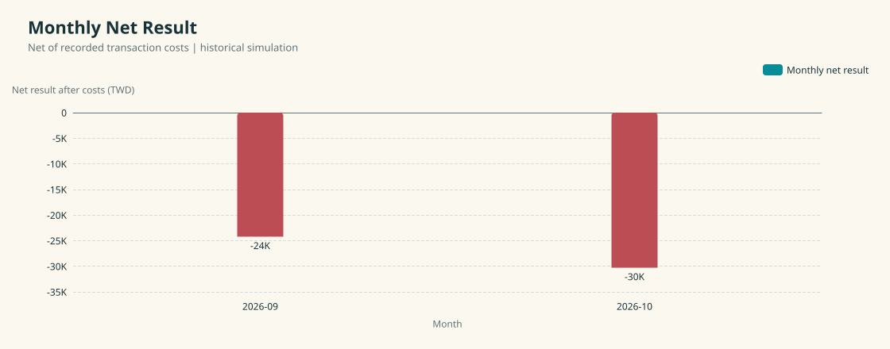
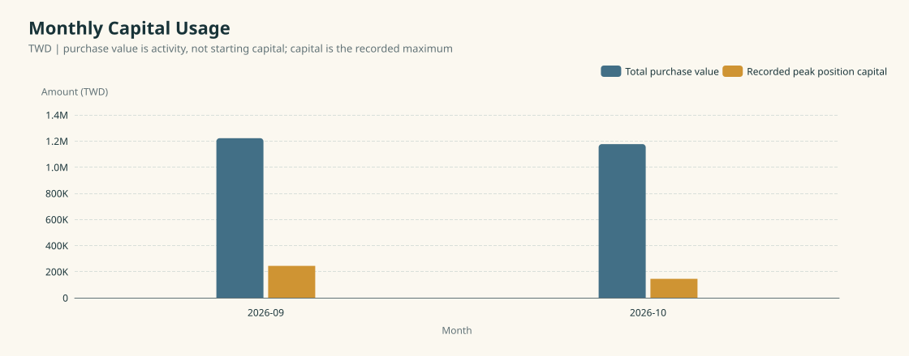
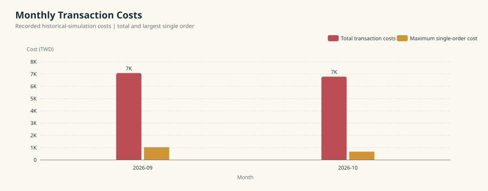

# Stock Decision System — Results

Results from historical replay of cross-day stock decisions, including recorded transaction costs.

## Latest Month — 2026-10

| Net result after costs | Total purchase value | Recorded peak position capital | Total transaction costs | Largest single-order cost |
|---:|---:|---:|---:|---:|
| TWD -30,278 | TWD 1,176,400 | TWD 145,207 | TWD 6,778 | TWD 657 |

The overview shows the latest selected month only. Earlier months appear below; financial results are not pooled across unverified comparison settings.

## 1. Monthly Net Result

Recorded monthly net results after costs. Changes alone do not establish improvement.

## 2. Monthly Capital Usage

Total purchase value and recorded peak position capital, shown on the same TWD scale. Purchase value measures activity, not starting capital.

## 3. Monthly Transaction Costs

How much did recorded transaction costs consume, and how large was the largest single-order cost each month?

## Observations and Next Steps

### 2026-09

- **Finding:** Recorded net result after costs: TWD -24,219; recorded transaction costs: TWD 7,069.
- **Limitation:** Recorded evaluation count: 12 with status `validated`. These aggregates alone do not establish sample representativeness or persistent performance. See the report limitations for context.
- **Next step:** Compare the next available month under a compatible revision and protocol, tracking net result, costs, and recorded capital together.

### 2026-10

- **Finding:** Recorded net result after costs: TWD -30,278; recorded transaction costs: TWD 6,778.
- **Limitation:** Recorded evaluation count: 12 with status `validated`. These aggregates alone do not establish sample representativeness or persistent performance. See the report limitations for context.
- **Next step:** Compare the next available month under a compatible revision and protocol, tracking net result, costs, and recorded capital together.

## Monthly Ledger

| Month | Status | Days | Evaluations | Net result after costs | Total purchase value | Recorded peak position capital | Total costs | Largest single-order cost |
|---|---|---:|---:|---:|---:|---:|---:|---:|
| 2026-09 | validated | 20 | 12 | TWD -24,219 | TWD 1,221,300 | TWD 244,348 | TWD 7,069 | TWD 1,020 |
| 2026-10 | validated | 19 | 12 | TWD -30,278 | TWD 1,176,400 | TWD 145,207 | TWD 6,778 | TWD 657 |

## Evaluation Context

| Period | Version | Evaluation protocol | Months | Recorded validation days | Evaluations |
|---|---|---|---:|---:|---:|
| 2026-09 to 2026-10 | `research-v0.1` | `historical-simulation-v1` | 2 | 39 | 24 |

All monetary amounts are in TWD. Total purchase value is the sum of purchases during the period; it is not starting capital. Recorded peak position capital is the maximum capital value supplied by the evaluation, not an assumed portfolio-wide funding requirement. Total costs and the largest single-order cost are distinct measures. Net result already includes recorded costs; do not subtract them again.

## Limitations

- Model and evaluation-setting comparability is not established. Months are shown separately without pooled results or cumulative performance.
- Correction recorded 2026-11-16: 2026-09 aggregates were replaced with the selected saved evaluation. Earlier figures are superseded.

## Reading These Results

Net result, notional, capital, and transaction costs are historical-simulation measurements. Month-to-month comparisons are meaningful only when the public revision and validation protocol remain comparable. Missing values are shown as unavailable rather than zero. Historical simulation is not actual execution; profitability has not been established.
